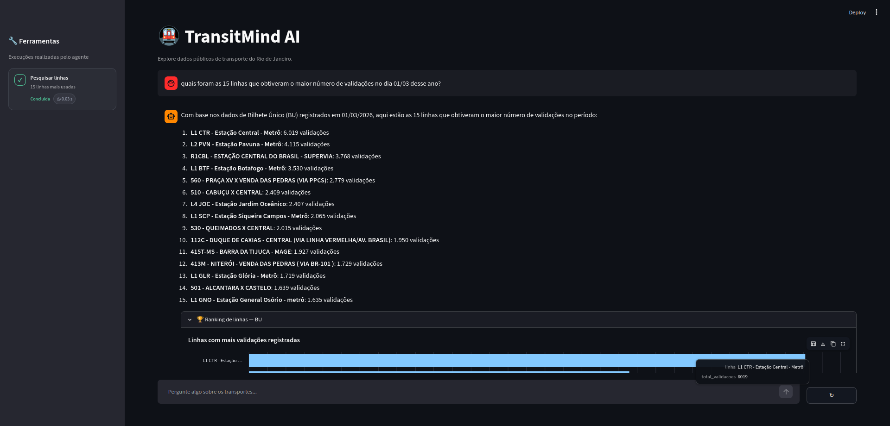
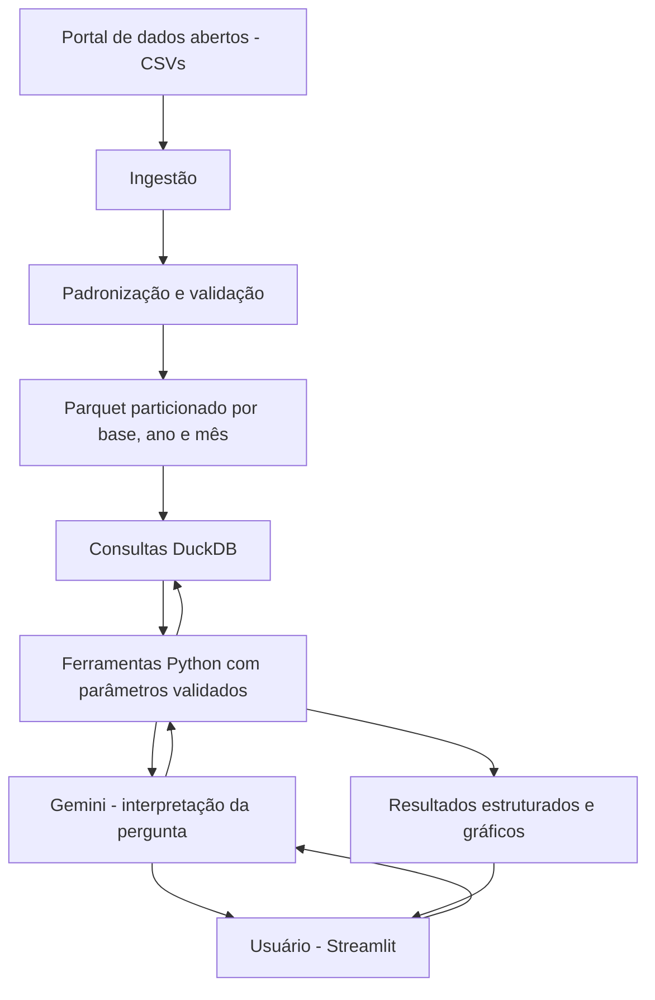

# TransitMind AI 🚇

**Os dados são abertos, mas nem sempre são acessíveis.**

O **TransitMind AI** é um protótipo de exploração de dados públicos de transporte do estado do Rio de Janeiro por meio de perguntas em linguagem natural. O projeto combina um agente de IA generativa com **consultas analíticas controladas** para transformar registros de bilhetagem em respostas e visualizações.

> **Status:** protótipo funcional em desenvolvimento. As funcionalidades dependem das bases e dos períodos previamente carregados. Não é uma ferramenta oficial da SETRAN-RJ nem está validada para apoiar decisões operacionais sem revisão humana.



## Por que este projeto existe?

O portal de dados abertos disponibiliza arquivos extensos de bilhetagem, com esquemas e regras específicas para cada base. Para responder a perguntas simples — por exemplo, quais linhas registraram mais validações em determinado dia — normalmente é necessário localizar os arquivos, compreender sua estrutura e escrever consultas ou análises.

O TransitMind busca reduzir essa barreira, permitindo que o usuário formule perguntas em português e receba resultados calculados sobre os registros disponíveis, sem precisar escrever SQL ou código Python.

## O que o protótipo faz hoje?

- **Busca linhas de transporte** por nome ou trecho do nome, utilizando um catálogo de linhas.
- **Produz rankings de linhas** por quantidade de validações registradas, considerando a base e o período informados.
- **Analisa validações por veículo observado e por hora** nas linhas elegíveis, distinguindo total de validações, veículos distintos observados e validações por veículo.
- **Exibe gráficos e tabelas** na interface Streamlit para os resultados suportados.
- **Registra eventos das ferramentas**, como execução, conclusão, falha e duração, para facilitar a inspeção das operações do agente.

O agente **não escreve SQL arbitrário**. Ele seleciona entre funções Python definidas pela aplicação; essas funções validam parâmetros e executam as consultas necessárias.

### Exemplos de perguntas

> “Quais foram as 15 linhas com mais validações registradas na base BU em 01/03/2026?”

> “Pesquise as linhas que passam pela Penha.”

> “Para a linha selecionada, mostre as validações e os veículos distintos observados por hora entre 07h e 10h de 01/03/2026.”

*Exemplos ilustrativos: a resposta depende da existência de registros e da elegibilidade da linha no período consultado.*

## Arquitetura



**Pipeline de dados:** os arquivos são obtidos da API CKAN do portal, processados com Pandas, convertidos com esquema explícito em PyArrow e armazenados em Parquet particionado pelo mês da transação. O projeto inclui mecanismos de registro de lotes concluídos e geração de catálogo para consulta de linhas.

**Fluxo de perguntas:** o Gemini identifica a ferramenta adequada e fornece seus parâmetros; o código Python faz as consultas via DuckDB e devolve resultados estruturados. A interface apresenta a resposta do agente e, para análises suportadas, gráficos gerados independentemente do texto do modelo.

## Tecnologias

| Componente | Tecnologias |
| --- | --- |
| Ingestão e pré-processamento | Python, Requests, Pandas |
| Armazenamento analítico | PyArrow, Parquet particionado |
| Consulta dos dados | DuckDB, SQL |
| Agente de IA | Gemini (`google-genai`), function calling |
| Interface e gráficos | Streamlit |
| Testes | Pytest |

## Bases de dados

A origem é o [Portal de Dados Abertos do Estado do Rio de Janeiro](https://dadosabertos.rj.gov.br/), com conjuntos publicados pela SETRAN-RJ:

| Base | Descrição |
| --- | --- |
| **BU** | Bilhete Único |
| **BE** | Bilhetagem Eletrônica |
| **GRATUIDADE** | Registros de gratuidade |

As três bases possuem diferenças de esquema e de representação de datas. A presença de uma base no pipeline **não significa que todo o seu histórico esteja processado ou disponível para consultas**.

Os dados processados não são incluídos neste repositório. Para trabalhar com o projeto, é necessário obter e preparar os arquivos adequados, respeitando as condições de uso da fonte.

## Decisões de engenharia e cuidados com a confiabilidade

**1. Funções controladas em vez de SQL livre.** O agente só tem acesso às operações de consulta implementadas. Isso limita a variedade de perguntas respondidas, mas oferece maior controle sobre parâmetros, cálculos e formatos de retorno.

**2. Semântica dos campos importa.** Em registros de BRT, por exemplo, `numero_carro` identifica uma estação, e não um veículo. Essas ocorrências são excluídas das análises de veículos distintos observados.

**3. Ausência de registros não significa ausência de serviço.** Um horário com zero validações nos arquivos consultados não comprova que uma linha deixou de operar. O agente recebe instruções explícitas para não tirar essa conclusão.

**4. Valores monetários usam precisão decimal.** O processamento emprega `Decimal` e esquemas de armazenamento com precisão fixa; a interpretação de valores ausentes depende de regras específicas da base e da coluna.

**5. Resultados têm limites de interpretação.** Validações registradas não equivalem a passageiros únicos, e veículos distintos observados não representam necessariamente a frota total em operação.

As escolhas e limitações de implementação são registradas em [Decisões técnicas](docs/decisoes_tecnicas.md).

## Organização do código

```text
src/
  agent/         # Configuração do agente, ferramentas e eventos
  analytics/     # Consultas DuckDB e busca de linhas
  data/          # Ingestão, esquemas, tratamento e armazenamento
  ui/            # Visualizações Streamlit
docs/            # Registro das decisões técnicas
tests/           # Testes automatizados
assets/          # Recursos auxiliares da interface
experiments/     # Scripts exploratórios de desenvolvimento
```

## Execução local e testes

**A preparação do ambiente está sendo documentada.** Para executar o agente e as visualizações, são necessários uma chave de API do Gemini, dependências Python e arquivos Parquet previamente gerados para os períodos desejados.

No próximo passo serão acrescentados e validados o manifesto de dependências, as variáveis de ambiente de exemplo e o comando de inicialização da aplicação. Até isso acontecer, esta seção **não deve ser interpretada como um guia de instalação completo**.

Há testes automatizados em `tests/`, executados com Pytest. A cobertura ainda é limitada e está sendo ampliada para as regras específicas de cada base, sobretudo em conversões monetárias e análise de datas e períodos.

## Limitações atuais

- Apenas as perguntas cobertas pelas ferramentas existentes podem ser respondidas por meio de cálculos controlados.
- A cobertura temporal depende dos arquivos efetivamente processados e disponíveis localmente.
- Algumas convenções operacionais dos campos exigem validação adicional por modal.
- O modelo pode interpretar perguntas ou explicar resultados incorretamente; as restrições e a rastreabilidade reduzem riscos, mas não garantem respostas infalíveis.
- O protótipo ainda não foi avaliado sistematicamente com usuários finais, portanto não há métricas comprovadas de economia de tempo ou melhoria na tomada de decisão.

## Próximos passos

- Documentar e testar a instalação em um ambiente limpo.
- Expandir a cobertura de testes automatizados.
- Ampliar as ferramentas analíticas e a cobertura dos períodos carregados.
- Preparar uma demonstração reproduzível com dados de exemplo e capturas de tela.
- Validar usabilidade e precisão com diferentes perfis de usuários.

---

**Projeto independente de portfólio, desenvolvido por [Nilo Zeribinate](https://github.com/NiloZeribinate).** Não representa uma ferramenta oficial da SETRAN-RJ.